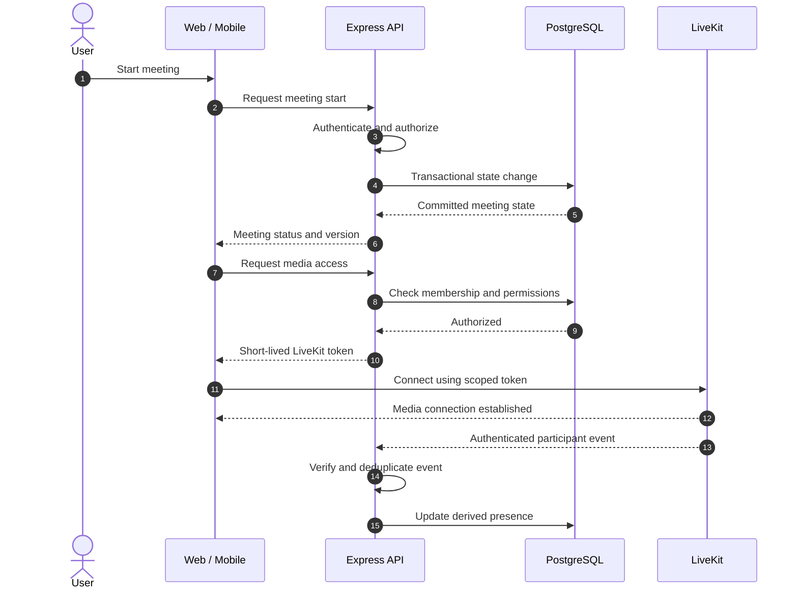
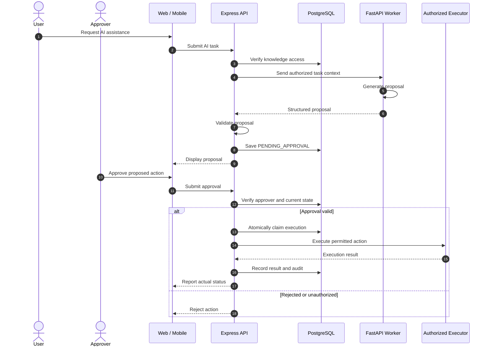
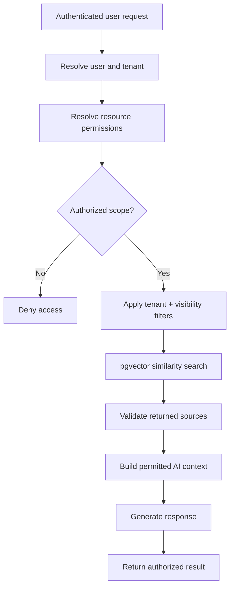

# Critical System Flows

## 1. Meeting Start and Participant Connection

This sequence distinguishes application state from LiveKit media state.

### Invariants

- Meeting state is authorized and persisted by the Express API.
- A successful media connection is not proof of business authorization.
- Joining a media room does not independently change meeting lifecycle state.
- Replayed events cannot create duplicate participants or transitions.
- Disconnection does not automatically imply the meeting has ended.

### Failure Scenarios

**Database failure:** The start operation must not report success without a committed state change.

**LiveKit unavailable:** The meeting record may remain valid while media connection fails. The UI must show a recoverable media error.

**Webhook duplicated:** Processing the duplicate must not change the result.

**Token expired:** The client must request a fresh authorized token.

## 2. AI Processing and Human Approval

### Invariants

- AI suggestions do not bypass human authorization.
- The approver must have the required capability.
- Action parameters must be revalidated at execution time.
- Execution must be protected against duplicates.
- Failed executions must be recorded honestly.
- Success must not be reported until execution is confirmed.
- Irreversible external effects require an execution and retry strategy suitable for that integration.

## 3. Knowledge Retrieval

### Privacy Requirements

- Private and shared resources are never searched together without an explicitly authorized union of scopes.
- Retrieval authorization occurs before content reaches the model.
- Generated summaries must not automatically gain broader visibility than their sources.
- Access revocation must be respected on future retrieval and result access.

## 4. Verification Scenarios

| Scenario | Expected result |
|---|---|
| Nonmember requests meeting token | Denied |
| User enters another tenant's meeting ID | Denied |
| LiveKit webhook delivered twice | Single effective state update |
| AI worker unavailable | Business API remains operational |
| Private document matches shared search | Private content excluded |
| Unauthorized user attempts approval | Denied and auditable |
| Approved action submitted twice | No duplicate effect |
| Permission revoked before execution | Execution denied |
| Expired media token reused | Connection rejected |

## 5. Observability

Track:

- Meeting state transition failures.
- Media token issuance and authorization failures.
- Webhook processing failures and duplicates.
- AI task duration and failure rates.
- Knowledge authorization denials.
- Approval outcomes and execution failures.
- Correlation IDs across API and worker operations.

Logging must preserve request correlation without exposing raw secrets, private documents, or unnecessary personal information.
