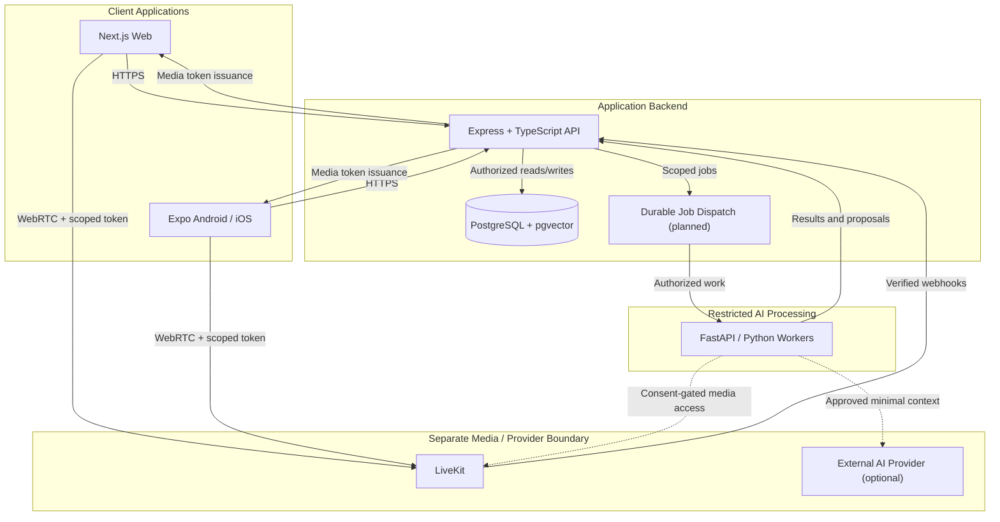

# System Context and Component Architecture

## Purpose

Define how Vaartiva's clients, business API, AI workers, media infrastructure, and persistence layers interact.

## Logical Architecture

## Component Responsibilities

### Web Application

- Display meetings, participants, knowledge, and AI suggestions.
- Manage browser UI state.
- Call authorized business API endpoints.
- Connect directly to LiveKit using scoped access tokens.
- Never hold persistent backend service credentials.

### Mobile Applications

- Provide native meeting and collaboration experiences.
- Use the same business API authorization model.
- Handle mobile microphone and camera permissions.
- Manage backgrounding, reconnection, and token expiration.
- Store session credentials using appropriate secure storage.

### Express Business API

- Authenticate users and authorize requests.
- Enforce tenant, meeting, and resource permissions.
- Own meeting and collaboration business state.
- Issue scoped media connection tokens.
- Manage knowledge visibility and sharing rules.
- Validate AI action approvals.
- Coordinate AI jobs and persist their results.
- Provide audit records for sensitive operations.

### FastAPI AI Workers

- Process explicitly authorized meeting information.
- Perform transcription, summarization, and retrieval.
- Generate structured action proposals.
- Return results to the application backend.
- Avoid unrestricted access to application data.
- Never independently approve privileged actions.

### LiveKit

- Transport real-time audio and video.
- Manage media rooms and media participants.
- Deliver connection and room events.
- Optionally support authorized media-processing agents.
- Never serve as the authoritative source for business permissions or meeting lifecycle state.

### PostgreSQL + pgvector

- Persist users, meetings, membership, permissions, and audit records.
- Store authorized knowledge and vector representations.
- Support transactional state changes.
- Preserve tenant and resource ownership metadata.

## State Ownership

| State | Authoritative owner |
|---|---|
| User and organization membership | Business API + PostgreSQL |
| Meeting lifecycle | Business API + PostgreSQL |
| Permission and consent records | Business API + PostgreSQL |
| Current media connection | LiveKit |
| Durable knowledge and embeddings | PostgreSQL |
| AI proposals and approval status | Business API + PostgreSQL |
| Transient client presentation state | Web/mobile client |

LiveKit events may update derived participant presence. They must not independently override authoritative business permissions.

## Communication Patterns

### Synchronous

Client -> Business API -> Database

Used for authenticated, user-visible business operations.

### Asynchronous

Business API -> Durable dispatch -> AI worker -> Business API

Target pattern for expensive AI operations. The dispatch mechanism is not selected by this document.

### Real-time

Web/mobile client -> LiveKit

Used for authorized audio/video transport.

### Event-driven

LiveKit -> Verified webhook -> Business API

Used to reconcile observable media events.

## Reliability Requirements

- Meeting mutations must use transactional persistence.
- Repeated requests must not create duplicate state transitions.
- Webhook delivery must tolerate retries and out-of-order events.
- Long-running AI processing must not block ordinary API requests.
- Background jobs require bounded retries and failure recording.
- Durable delivery should use a queue or transactional outbox pattern before production reliance.
- Meeting authorization must continue working when AI services are unavailable.

## Open Architecture Decisions

- Durable job-queue technology.
- LiveKit managed versus self-hosted deployment.
- Recording and transcript storage provider.
- Production service identity mechanism.
- Model provider and data-processing agreements.
- Final meeting lifecycle status names.

These decisions should be tracked in future architecture and implementation PRs rather than silently assumed.
