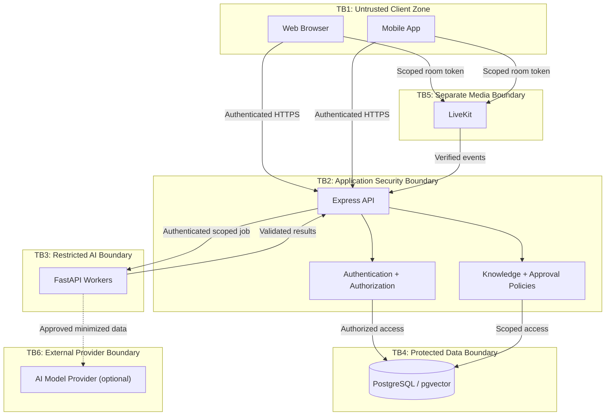

# Vaartiva Trust Boundaries

## Objective

Document where Vaartiva crosses security boundaries and what must be verified before information or operations move between them.

## Trust Boundary Diagram

## Trust Boundaries

### TB1: Client to Business API

Clients are untrusted.

Required controls:
- Validate session identity server-side.
- Authorize each resource operation.
- Validate request payloads and file metadata.
- Rate-limit sensitive endpoints.
- Never accept client-supplied roles or resource ownership as proof.
- Never expose signing keys or database credentials.

### TB2: API to Restricted AI Workers

AI processing must receive only the resources necessary for an authorized task.

Required controls:
- Authenticate service-to-service requests.
- Send scoped task identifiers and permitted context.
- Validate worker output against an expected schema.
- Reject unauthorized resource references.
- Apply execution deadlines and resource limits.
- Treat prompts and model outputs as untrusted data.

AI workers cannot grant new permissions to themselves.

### TB3: Application Services to Data Storage

PostgreSQL is a protected resource.

Required controls:
- Use narrowly scoped database credentials.
- Enforce authorization before business queries.
- Use parameterized queries.
- Isolate tenant-owned resources.
- Maintain auditable permission changes.
- Use database-level isolation where practical as defense in depth.

### TB4: Clients and Services to LiveKit

Media access is separate from application authorization.

Required controls:
- Issue short-lived tokens only after backend authorization.
- Restrict each token to the intended room and capabilities.
- Do not expose LiveKit API secrets to clients.
- Verify incoming webhook authenticity.
- Recheck permissions when issuing renewed access.
- Enforce consent policies before recording or transcription.

### TB5: AI Processing to External Providers

External AI providers are a separate data-processing boundary.

Required controls:
- Send only task-required content.
- Avoid transmitting private documents without authorization.
- Apply consent and organizational data policies.
- Review provider retention and processing terms.
- Never include backend secrets in model prompts.
- Log metadata without recording sensitive prompt contents by default.

## Knowledge Classification

| Scope | Who may access |
|---|---|
| Private | Owner and explicitly authorized principals |
| Meeting-shared | Authorized participants according to meeting policy |
| Organization-shared | Authorized members of that organization |

"Shared" does not mean publicly accessible on the internet.

Every knowledge record and embedding must retain the ownership and visibility metadata needed to enforce access control.

## Knowledge Retrieval Invariants

1. Authenticate the requesting principal.
2. Determine their permitted tenant and resource scopes.
3. Restrict candidate retrieval to authorized records.
4. Apply visibility and ownership filters before returning context.
5. Preserve source permissions through summarization and derived content.
6. Never let similarity scores override authorization.
7. Revalidate permissions when previously generated knowledge is accessed.

For an initial implementation, PostgreSQL query filters should combine authorized scope with vector similarity. Row-level security may be added as defense in depth.

## AI Action Approval Boundary

AI-generated content is a proposal, not an instruction with authority.

Required state transition:

PROPOSED -> PENDING_APPROVAL -> APPROVED -> EXECUTED

Alternative terminal states include REJECTED, EXPIRED, and FAILED.

Before execution, the business backend must:
- Authenticate the approver.
- Check their authority for the exact action.
- Verify the proposal is still valid.
- Validate parameters and target resource ownership.
- Enforce idempotency.
- Record the approval decision.
- Execute through an explicitly permitted application capability.

A model response or worker callback must never directly authorize a privileged mutation.

## Consent and Privacy

- Recording and transcription require applicable consent and permission checks.
- Permission revocation must prevent new authorized access.
- Retention and deletion policies must cover raw and derived data.
- Logs must avoid unnecessary personal information and secrets.
- Sensitive knowledge must not cross tenant or visibility boundaries.

## Threats and Mitigations

| Threat | Required mitigation |
|---|---|
| Forged client role | Backend authorization |
| Cross-tenant retrieval | Tenant and ACL filters |
| Prompt injection | Treat model outputs as untrusted |
| Forged media webhook | Webhook signature verification |
| Replayed approval | Idempotency and state validation |
| Leaked media token | Short lifetime and narrow grants |
| Unauthorized transcription | Consent and permission enforcement |
| Excessive worker privileges | Least-privilege service identity |

## Security Review Rule

Any new service, external integration, information-sharing feature, or privileged AI action must be reviewed against these trust boundaries before implementation.
