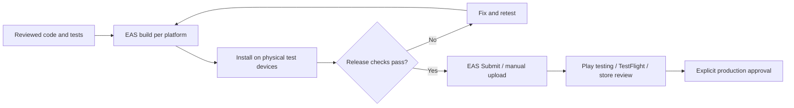

# Expo EAS Build and Distribution Strategy

**Status:** Proposed. Commands below are **future implementation guidance**, not tasks executed by this docs PR.  
**Package manager:** Bun exclusively for JavaScript and TypeScript.

## Ownership and identifiers

- Select one Expo organization/project owner before creating CI tokens or production builds.
- Reserve stable, globally unique application identifiers: Android `applicationId` / Expo `android.package` and iOS `bundleIdentifier`.
- Record the Expo project ID and store app identifiers when created; do not invent values in advance.
- Treat package and bundle identifiers as release identity; changes after store publication can require a separate app listing.
- Avoid sharing production backend or AI service secrets through Expo public environment variables.

## Environment model

| Profile | Intended use | Android artifact | iOS path | Availability |
| --- | --- | --- | --- | --- |
| Development | Native development with Expo dev client | Installable debug/development APK | Signed device development build or simulator build | After build setup |
| Preview / internal | QA outside the editor | Installable APK | Signed ad hoc build for registered iPhones, or TestFlight if uploaded appropriately | After signing/access setup |
| Production | Store-ready candidate | AAB | Signed App Store build / IPA for submission | After store prerequisites |

Production Play uploads normally use **AAB**, not an APK generated only for direct installation. A build being uploaded to a store does not automatically mean it has passed review or is public.

## Proposed workflow



### Future command examples (run only when Expo app and accounts are ready)

```bash
# In the Expo mobile app workspace; retain Bun as the JS package manager.
bun add -D eas-cli
bunx eas login
bunx eas build:configure

# Build installable Android preview after eas.json is approved.
bunx eas build --platform android --profile preview

# Build Android store candidate (AAB) when signing is configured.
bunx eas build --platform android --profile production

# Build iOS store candidate after Apple membership and signing access.
bunx eas build --platform ios --profile production

# Upload after checks, store entry, and uploader permission are ready.
bunx eas submit --platform android --profile production
bunx eas submit --platform ios --profile production
```

**Do not add or run these commands in VRT-007.** The implementation PR should review Expo SDK compatibility, configure `eas.json`, versioning, project ownership, signing, and CI identities. Pin tested versions of Bun/EAS when that work begins. EAS cloud builds can run from Linux; local iOS Simulator/Xcode work still needs macOS.

## Release workflow controls

1. PR review and automated checks run before building a release candidate.
2. Version / build number is unique and traceable to commit SHA.
3. Dev/staging API endpoints never silently appear in production releases.
4. Credentials are provisioned through permitted service-specific secret management, not Git.
5. Account owners approve store submissions and production rollouts.
6. Store review, testing track approval, and staged rollout statuses are observed separately.
7. Crash/ANR telemetry and rollback/halt procedures exist before broad release.
8. EAS Update (if later adopted) must not bypass native binary compatibility or app review requirements.

## Sensitive configuration restrictions

- `EXPO_PUBLIC_*` values are **public** to anyone inspecting an installed app. Store only nonsecret public configuration there.
- Never embed LiveKit server API secrets, Apple private keys, Play service account JSON, database credentials, AI provider API keys, or admin tokens in app binaries.
- Mobile clients request scoped LiveKit access tokens from the authenticated Express API.
- Use least-privilege upload credentials; avoid sharing human passwords with CI.

## Official references

- [Expo: Using Bun](https://docs.expo.dev/guides/using-bun/)
- [Expo: Build configuration and build profiles](https://docs.expo.dev/build/eas-json/)
- [Expo: EAS build setup](https://docs.expo.dev/build/setup/)
- [Expo: Store submissions](https://docs.expo.dev/deploy/submit-to-app-stores/)
- [Expo: Internal distribution](https://docs.expo.dev/build/internal-distribution/)
- [Expo: Submit Android](https://docs.expo.dev/submit/android/)
