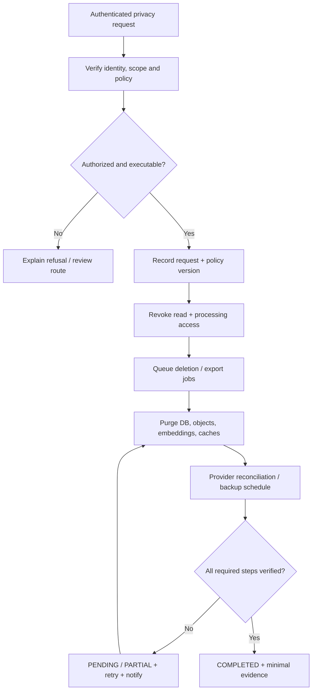

# Data Deletion, Export, and Privacy Requests

**Status:** Proposed service contract; user-facing legal deadlines require jurisdiction review.

## 1. Supported request types

- Access to personal information held under a user's identity, subject to authentication and applicable limits.
- Export of permitted user content and explainable metadata, scoped to current permissions and rights.
- Deletion of owned private documents, recordings under approved policy, notes, and user/account data.
- Withdrawal of an identified processing consent without needing full account deletion.
- Correction of appropriate profile data and dispute of incorrect consent evidence, where relevant.

Do not confuse **deleting an account** with **leaving an organization**, **revoking meeting participation**, **deleting shared content**, or **withdrawing recording consent**. Each can affect different resources and other participants.

## 2. Core lifecycle

**Statuses:** `REQUESTED`, `VALIDATING`, `APPROVED`, `IN_PROGRESS`, `PARTIAL`, `COMPLETED`, `REJECTED`, `ON_HOLD`, `FAILED` (exact names proposed, not a migration design).

## 3. Deletion scope and order

1. Authenticate requester and resolve account/tenant ownership, current memberships, and exact resource IDs.
2. Determine lawful purpose, scope, retention duties, third-party participant rights, account billing state, and any documented legal holds.
3. Commit a tombstone/deny-access change immediately to prevent new reads, retrieval, sharing, AI indexing, exports, and task creation.
4. Cancel and invalidate relevant AI jobs, cached context, cached results and short-lived capabilities.
5. Delete authorized primary content, attachments, recordings, transcript segments, AI outputs, vector chunks/embeddings and object derivatives.
6. Revoke Vaartiva-managed URLs and grants; confirm deletion from controlled external processors where API/contract permits.
7. Verify affected resources are absent from online stores, search results and authorized exports; retain only minimal required audit proof.
8. Reconcile backup expiration and guard any restore by reapplying tombstones before opening access.
9. Report accurately which operations completed, which are pending, and which cannot be reversed (for example, copies downloaded by others).

## 4. Account closure

- Provide a discoverable in-app initiation path for Android and iOS account deletion, with an appropriate web request path for Google Play where required.
- Require fresh authentication for irreversible operations and prevent destructive requests from another tenant.
- Distinguish user-owned private content from organization-owned shared documents; use relevant ownership, legal, and contract rules.
- Revoke sessions, membership and ability to request new media tokens; propagate restrictions to AI systems.
- Explain whether organization-shared content attributed to the user remains, is pseudonymized or is deleted under an approved policy; do not guess.
- Track subprocessors and storage buckets for personal data, including provider logs where included in deletion obligations.

## 5. Shared conversations and participant withdrawal

A meeting recording/transcript contains multiple people's information. One participant's withdrawal or deletion request may require **redaction, suspension of access, stopping capture, or legal review**; it does not automatically mean the requester has authority to erase every other participant's records. Do not promise automatic removal of a person's words from a mixed recording before a technically and legally valid mechanism exists.

If safe partial deletion is not implemented, gate availability of affected recording/transcription features or quarantine affected content pending a documented manual review. A summary containing a withdrawn participant's private content may need regeneration from still-authorized sources.

## 6. Export requirements

- Recheck permission at generation and download time; do not allow another tenant's material into export.
- Secure links must expire and be revocable; exported archives must not contain raw credentials, private notes of others, or internal debugging data.
- Identify export provenance, permitted audience and retention; explain that Vaartiva cannot retract files already downloaded elsewhere.

## 7. Holds, operational evidence, and timelines

- Record hold reason/category, approver, affected resource set, expiration/review date and access restrictions. Holds must not become general-purpose indefinite retention.
- Separate retention of evidence from retention of raw content: a hashed/metadata receipt may establish deletion progress without keeping deleted transcripts.
- **Proposed engineering objective:** online deletions reconciled within 24 hours of approved execution; **not** a jurisdictional legal response deadline. Legal request acknowledgment and completion deadlines remain TBD until reviewed.
- Provider or backup retention may exceed this operational target; disclose exceptions and block inaccurate 'fully erased' claims.
- All statuses need observable metrics, retries, ownership and escalation.

## 8. Test scenarios

- Owner deletes private note -> no API retrieval, vector hit, AI cached answer, or export after deny-access commit.
- Unauthorized organization admin requests user's private data -> denied.
- Meeting participant requests deletion of whole meeting -> fails absent authority and approved scope.
- Deleted data restored from backup -> tombstone replay blocks read and AI before service becomes available.
- Provider deletion fails -> `PARTIAL`/`FAILED`, alerts and retries; never `COMPLETED` prematurely.
- Account deletion initiated in app -> identity checked, associated personal data workflow started, honest status visible.
