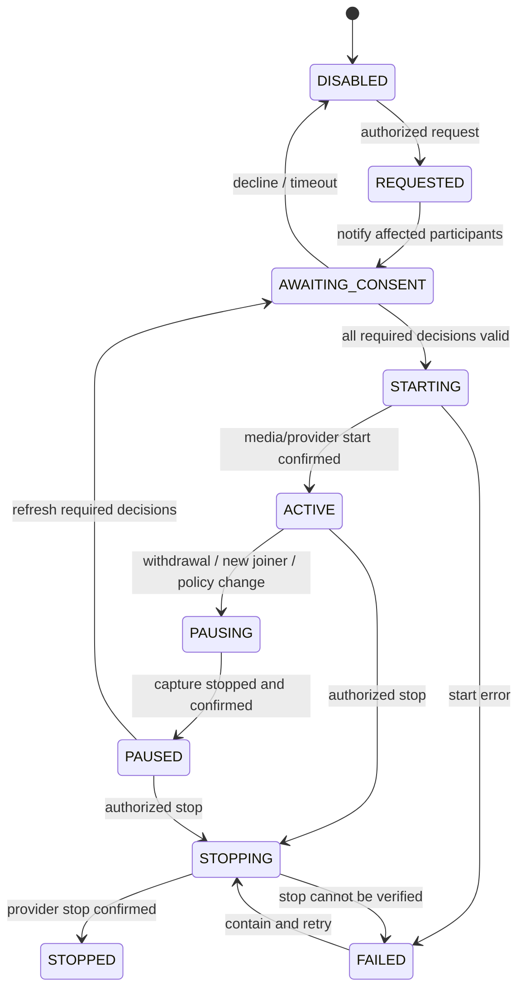

# Recording and Transcription Consent — Meeting Flow

**Status:** Proposed design, not working code.  
**Dependencies:** [AI consent](./ai-consent-policy.md), [consent events](./consent-event-contract.md), [VRT-005 architecture](../architecture/README.md).

## 1. Media and processing boundaries

- The **Express API** is the policy decision/enforcement point and records authoritative consent state in PostgreSQL.
- LiveKit transports meeting audio/video and provides egress/agent capabilities but is **not the source of business authorization**.
- FastAPI workers may receive only the media/transcript fragments necessary for an authenticated, currently permitted task.
- Web and Expo clients display authoritative states and offer controls; client-side flags alone cannot permit capture.
- Don't configure **auto egress** or agent media subscription that begins before consent validation. OS microphone/camera grants do **not** authorize server recording or AI transcription.

## 2. Independent capability state machines

Use separate state machines for **recording**, **transcription**, and **AI listening**. A recording grant must not start transcription automatically.



`PAUSING` and `STOPPING` are **not** evidence that capture has stopped. If backend cannot confirm an immediate stop, remove egress/agent media access, trigger an incident/alert and show a safe failure state; do not falsely display `STOPPED`.

## 3. Start recording (example)

```mermaid
sequenceDiagram
    autonumber
    actor Host
    actor Participant
    participant UI as Web / Mobile
    participant API as Express API
    participant DB as PostgreSQL
    participant LK as LiveKit Egress

    Host->>UI: Request recording
    UI->>API: Start request
    API->>DB: Validate meeting + host permissions
    API->>DB: Store AWAITING_CONSENT
    API-->>UI: Show pending state
    API-->>Participant: Present recording notice and choice
    Participant->>API: Explicit grant/decline
    API->>DB: Append versioned decision
    API->>DB: Recheck all participants, policy, version
    alt All required consent valid
        API->>LK: Start approved egress
        LK-->>API: Start acknowledged
        API->>DB: Persist ACTIVE + provider ID
        API-->>UI: Display persistent recording indicator
    else Missing, denied, or stale
        API-->>UI: Recording remains disabled/pending
    end
```

This is an illustrative logical flow; delivery of participant notifications, command ordering, webhook verification, idempotency, and egress-failure handling must be engineered in implementation PRs.

## 4. Late joiners, reconnects, and disconnects

- Before admitting newly published media tracks to any active capture/AI processing path, re-evaluate the capture participants and their effective consent.
- If a new joiner has not accepted capture, pause whole-room capture, or exclude that person's tracks only after selective capture is verifiably reliable. Re-consent and resume on media-confirmed state.
- Participant rejoining with a different session/device must not imply a fresh grant unless the stored consent remains valid under the approved session/purpose policy. Require renewed notices when circumstances changed.
- A participant disconnecting must not automatically invalidate historical consent, but pending/existing capture must honor current policy and all active affected contributors.
- If the AI participant starts subscribing to tracks or a second provider is introduced, treat this as a distinct processing boundary that may require new notice/consent.

## 5. Withdrawal during active capture

1. Receive authenticated participant withdrawal and commit a versioned event.
2. Deny future authorized capture on the relevant track/meeting purpose.
3. Stop/pause egress and AI audio subscriptions; fail closed when selective exclusion is not proven.
4. Prevent queued AI tasks from processing revoked material, including retries and provider fallback.
5. Update all client indicators based on reconciled provider/server state.
6. Provide a separate deletion request pathway for already captured content and explain lawful exceptions.
7. Emit minimal audit metadata and alert if capture cannot be stopped promptly.

## 6. No silent recording / hidden AI

- Visible, persistent recording or transcription status while active; clear text and accessible announcement for screen-reader users.
- Show AI participant identity/purpose and whether it is listening, transcribing, or speaking.
- A host's UI cannot hide an active recorder or change participants' recorded consent.
- Explicitly indicate when any recording/export is performed outside Vaartiva's own product controls (for example, by user OS software, where detectable) without falsely promising technical prevention.
- Treat egress webhooks as external events: validate authenticity, deduplicate, reconcile to consent state. No webhook alone authorizes processing.

## 7. Failure matrix

| Situation | Expected behavior |
| --- | --- |
| Recording requested, one participant declines | Recording never starts; normal call may continue |
| Another participant joins while recording | Pause or reliably exclude until fresh eligibility decision |
| Consent revoked during active transcription | Stop affected transcription; no new model calls for revoked material |
| AI worker crashes | Do not restart capture until consent/current state revalidated |
| LiveKit start succeeds but API times out | Reconcile egress ID/state; stop orphan if unauthorized; never assume safely off |
| Provider stop call times out | Escalate containment, retry/reconcile, avoid a false 'stopped' indicator |
| Two users click Start simultaneously | Single effective start operation via idempotency/lock |
| Recording stored but source permission later revoked | Immediate read denial, derivative invalidation, deletion review |

## 8. Implementation guidance

- Define an event-driven, idempotent reconciliation worker for recording/agent state. Protect concurrent state transitions using a meeting/capability version.
- Use short-lived capability tokens where supported. No LiveKit API secret in mobile/web client.
- Disable unapproved diagnostics recording and automatically recorded traces in provider dashboards.
- Bind recording objects to meeting, tenant, creator, permitted viewers, source consent evidence, and expiry schedule.
- Test with staging tracks and consenting synthetic participants on real Android and iPhone devices before beta.
