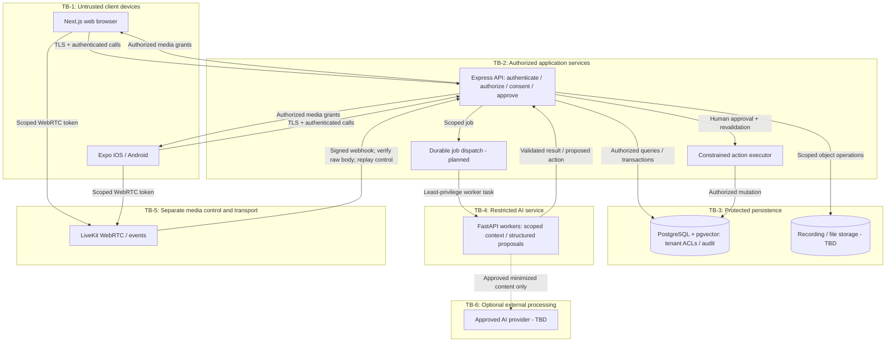

# Threat Model and STRIDE Analysis

**Status:** Proposed; no implementation guarantees. **Scope:** Vaartiva MVP.

## 1. Security goals and assets

| Asset | Why it matters | Expected boundary |
| --- | --- | --- |
| Session tokens, signing secrets and service credentials (`RESTRICTED`) | Impersonation or unauthorized service access | Managed server-side; never shipped to clients or models |
| User, organization and meeting membership | Determines permission to enter media and read data | Express API + PostgreSQL are authoritative |
| Private notes, documents and attachments (`CONFIDENTIAL`, `PRIVATE`) | Disclosure can expose personal/business information | ACL checked for every read, share and derived artifact |
| Transcripts, recordings and summaries (`CONFIDENTIAL`) | Sensitive content; may require consent | Enforced audience, consent and retention |
| Embeddings, chunks and semantic search results | May disclose content, metadata, existence or access patterns | Scope-checked candidate selection and provenance |
| AI action proposals, approvals and execution records | May alter external data or collaboration state | Backend-verified human decision and audit trail |
| LiveKit join tokens, participant metadata and webhooks | Can allow media access or forge presence | Scoped tokens, verified callbacks and derived presence only |
| Logs, exports, cached responses and backups | Often overlooked copies of private information | Classified, access-controlled and retention-managed |
| Mobile builds, update channels and signing credentials | Tampering and credential leakage | Controlled build identities, signed artifacts, secure storage |

Separate **sensitivity** (`PUBLIC`, `INTERNAL`, `CONFIDENTIAL`, `RESTRICTED`) from **visibility** (`PRIVATE`, `MEETING`, `ORGANIZATION`) exactly as VRT-006 specifies. Public user-content visibility is not part of the MVP. The authorized audience for a derived answer must satisfy all relevant source constraints.

## 2. Threat actors / motivations

| Actor | Examples of capabilities | Typical objective |
| --- | --- | --- |
| Anonymous internet user | Can send arbitrary requests, links and large inputs | Abuse endpoints, enumerate users, drain resources |
| Authenticated but unauthorized user | Has valid session for a different meeting/tenant | Read private meetings or change membership |
| Malicious meeting participant | Can speak, chat or upload permitted content | Manipulate summaries, induce actions, disrupt session |
| Compromised device/session | Controls locally cached tokens or UI | Impersonation and data access |
| Compromised/insecure integration | Can send or alter webhook/worker callback | Forge events, escalate permissions, exfiltrate data |
| Malicious document/prompt author | Controls untrusted text passed into AI | Override intended instructions, leak data, trigger tools |
| Insider with limited role | Can invoke certain legitimate administrative actions | Overreach beyond resource-specific authorization |
| Abusive automated client | Can flood join/token/task endpoints | Availability and cost degradation |

These are modeled capabilities, **not allegations** about any actual users.

## 3. Assumptions, entry points and exclusions

**Assumed:** Public web/mobile clients are untrusted. API and DB are separate privileges. FastAPI is less privileged than the business API. LiveKit is a distinct media domain; an external AI model provider is possible but not yet selected. Durable job dispatch is planned, not implemented. EAS builds do not turn bundled JavaScript variables into secrets.

**Entry points:** Login/session refresh; organization/meeting APIs; LiveKit token endpoint; LiveKit webhook endpoint; upload/import pipeline; AI task initiation; worker callback; knowledge search/export; AI approvals; mobile deep links, device storage and OTA/update pipeline.

**Not concluded in this document:** exact auth provider, legal consent requirements by jurisdiction, vendor contractual controls, adversarial model performance, physical security of devices, or production network topology. Each needs its own design/review decision.

## 4. Security data-flow diagram

This is a logical DFD and boundary map, **not a claim that these services are already deployed**. Recording ingestion/storage and AI callback transport must be detailed in future implementation design. Media traffic can connect to LiveKit directly; it must never be treated as proof of membership.

## 5. Trust boundary rules

| Crossing | What is untrusted | Required enforcement | Risks |
| --- | --- | --- | --- |
| TB-1 -> TB-2 | Client role, tenant ID, resource IDs, session contents | Server authentication, resource ACLs, payload validation, rate limits | TH-001, TH-002, TH-011 |
| TB-2 -> TB-3 | App query parameters, scoped data writes and caches | Tenant filters, least-privileged DB identities, row-level defense in depth where viable | TH-002, TH-003, TH-014 |
| TB-2 -> TB-4 | Job payload, service identity, callback result | Authenticated dispatch, scoped capability, schema validation, deadline | TH-006, TH-008, TH-015 |
| TB-4 -> TB-6 | Prompts, external processing request | Provider allowlist, consent/policy check, minimal context, no secrets | TH-006, TH-007, TH-015 |
| TB-1 -> TB-5 | Media join token/participant metadata | API-issued room-bound short-lived grants; LiveKit enforcement | TH-004, TH-012 |
| TB-5 -> TB-2 | Webhook body and ordering | Verified signature/auth, raw-body handling, replay/idempotency | TH-005 |
| TB-2 -> action executor | Approval, model proposal, idempotency | Exact-action human authorization, state-version match, execution-time checks | TH-008, TH-009 |
| Client -> device/update ecosystem | Cached auth, build variables and deep links | Secure storage, no embedded secrets, verified links/build pipeline | TH-010, TH-016 |
| Upload -> API/AI/storage | File and embedded instructions | Content-type/size checks, malware scanning as applicable, sandboxing | TH-006, TH-017 |

## 6. STRIDE lens

| Category | Vaartiva example | Control objective |
| --- | --- | --- |
| **S**poofing | Forged webhook, stolen token, fake worker response | Verify caller/service identity, signature and token grants |
| **T**ampering | Client edits `tenant_id`, approval parameters, uploaded document | Validate schema and immutable action/ACL bindings |
| **R**epudiation | Approver denies initiating a destructive action | Tamper-evident audit metadata and actor correlation |
| **I**nformation disclosure | Vector search returns a private chunk | Pre-ranking authorization and source-bound results |
| **D**enial of service | Bot repeatedly starts AI transcriptions | Per-principal quotas, bounded cost, timeouts and backpressure |
| **E**levation of privilege | Meeting participant becomes host via client parameter | Role + resource checks in API and before side effects |

**AI-specific additions:** prompt injection, context poisoning, excessive tool agency, external provider leakage, and unsafe generated output (OWASP LLM catalogue). STRIDE alone does not fully express those threats.

## 7. Critical security invariants

- Authentication is necessary but not sufficient; every resource operation verifies current effective tenant and ACL.
- Sharing requires explicit permission and preserves source provenance/consent.
- Semantic candidate selection is limited to authorized resources **before vector ranking**; post-hoc filtering alone is insufficient.
- No model/tool output can change ACLs, approve actions or bypass backend business validation.
- Approval binds to exact action, parameters, target resource, version and authorized human; retries must not multiply side effects.
- LiveKit participant/leave events may update **derived presence** only, never grant business membership or mark a meeting ended automatically.
- Revocation blocks subsequent API/search/export and token renewals; previously issued media tokens may require disconnect or expiry.
- Recording/transcription and external processing require applicable consent and documented policy.
- No server secret enters `EXPO_PUBLIC_` values, Next.js public environment variables, prompts, logs or accessible mobile bundles.

## 8. Follow-up decisions

1. Decide identity provider, session lifecycle, refresh storage and compromised-session revocation.
2. Approve external AI providers, consent policy and recording/transcript retention.
3. Choose job dispatch, callback authentication and exactly-once **effect** strategy (at-least-once delivery may still occur).
4. Decide how media revocation and webhook deduplication are enforced in the actual LiveKit deployment.
5. Define data purge behavior for recordings, summaries, chunks, embeddings, caches and backups.
6. Review share/guest rules, link expiry, exported copies and organization ownership transfer.

## Sources

- [OWASP Threat Modeling Cheat Sheet](https://cheatsheetseries.owasp.org/cheatsheets/Threat_Modeling_Cheat_Sheet.html)
- [OWASP API Security Top 10](https://api-security.owasp.org/editions/2023/en/0x11-t10/)
- [OWASP LLM Top 10](https://genai.owasp.org/llm-top-10/)
- [LiveKit webhooks and events](https://docs.livekit.io/intro/basics/rooms-participants-tracks/webhooks-events/)
- [Expo environment variables](https://docs.expo.dev/eas/environment-variables/)
