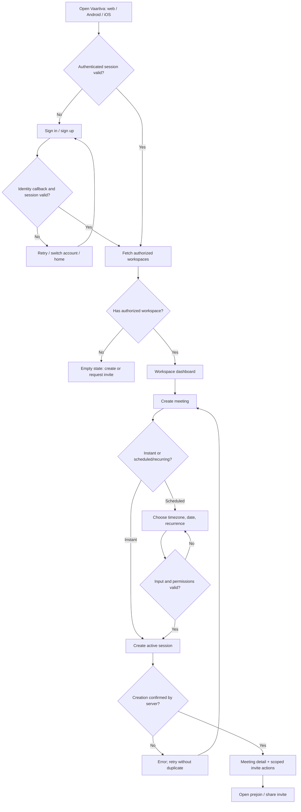
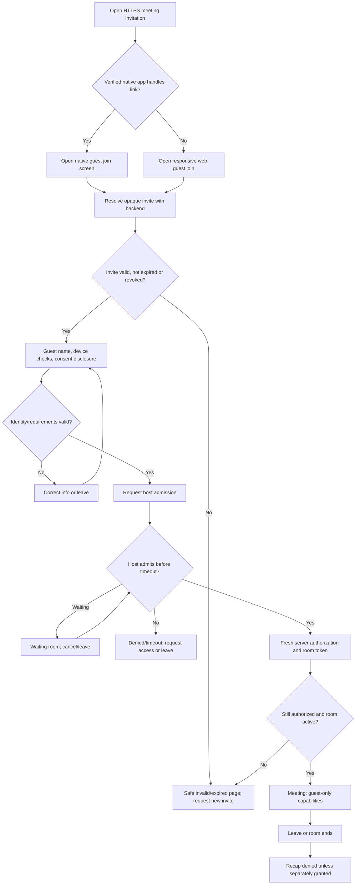
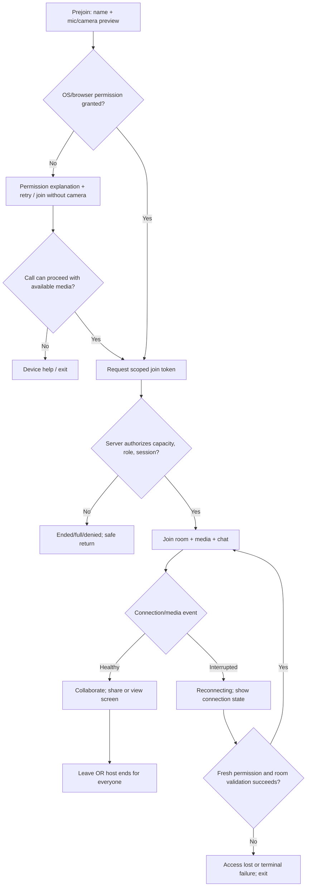
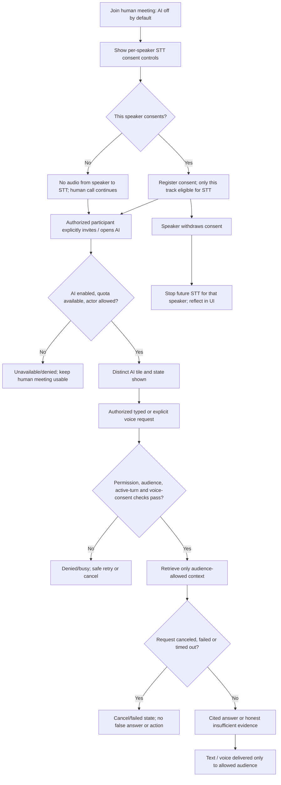
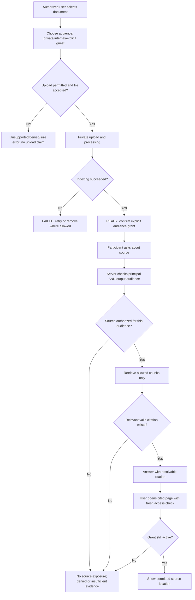
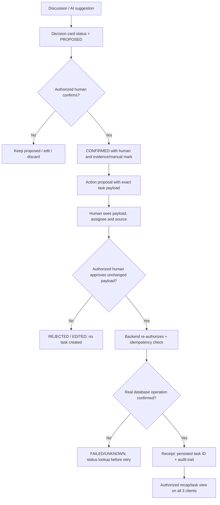
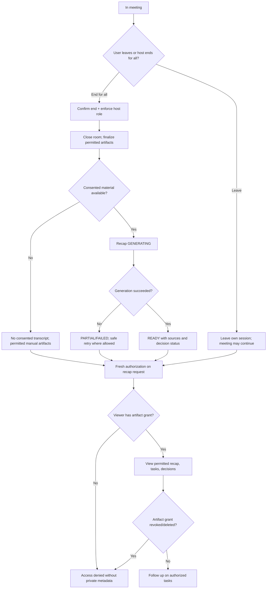
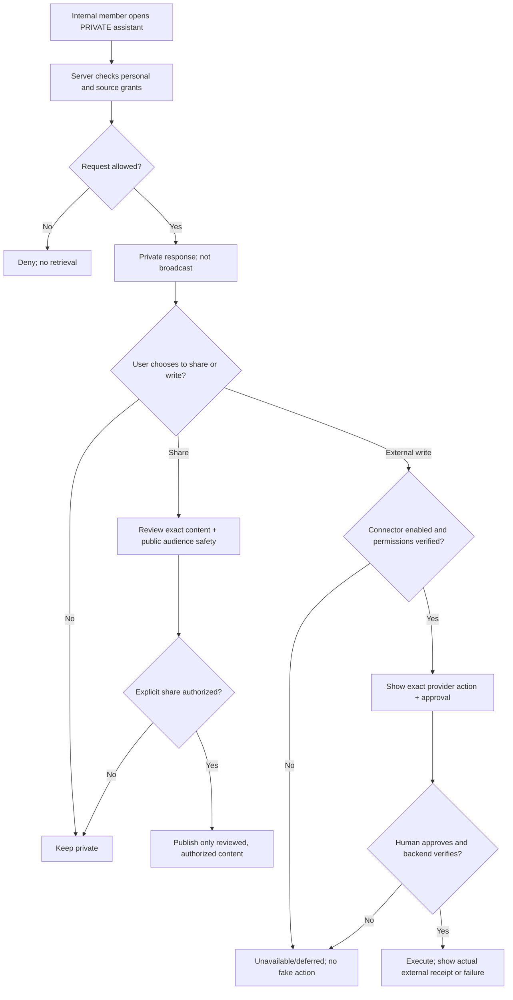

# Vaartiva — Low-Fidelity User Flow Diagrams

> **Issue:** VRT-003 · **Status:** Proposed, not implementation or tested UX · **Owner role:** Product / UX Lead (pending)  
> **See also:** [Journey Map](./USER_JOURNEYS.md) · [State Matrix](./STATE_AND_ERROR_MATRIX.md) · [Mobile Navigation](./MOBILE_NAVIGATION_AND_DEEP_LINKS.md)

## 1. Diagram conventions

- Rectangles: UI or server-observed state; diamonds: user or policy decision; edges: trigger/result.
- *Authorize* means **server-side** identity, meeting and audience checks; a client-side conditional alone never grants access.
- The routes and screen labels are **design placeholders**. No implementation exists from these diagrams.
- Mermaid is maintained as editable source inside GitHub Markdown. A future Figma diagram may link to these IDs, but is not claimed to exist.

### FD-01 — Member sign-in, workspace and instant/scheduled creation (UJ-01/UJ-02/UJ-03)

### FD-02 — Guest HTTPS invitation, native link, admission and rejection (UJ-04)

### FD-03 — Prejoin, media permissions and reconnection (UJ-02/UJ-05/UJ-11)

### FD-04 — Speaker consent, AI invocation, voice/text, cancellation and failure (UJ-06)

### FD-05 — Document ingestion, sharing and guest-safe grounded retrieval (UJ-07/UJ-10)

### FD-06 — Proposed decision → approval → verified internal task (UJ-08)

### FD-07 — End, recap and rights after the meeting (UJ-09/UJ-12)

### FD-08 — Private assistant and optional connector write (UJ-10)

## 2. Diagram-to-test handoff

| Diagram | Core decisions to test | Negative path that must not be omitted |
|---|---|---|
| FD-01 | Session/auth validity, workspace authorization | Removed member cannot see stale workspace |
| FD-02 | Verified link, invite, admission, token issuance | Revoked or forwarded guest link rejected correctly |
| FD-03 | OS permissions, room capacity, reconnection | Rejoin cannot bypass fresh server authorization |
| FD-04 | Speaker consent and active AI authorization | Nonconsenting voice excluded from STT; public/private leak denied |
| FD-05 | Document audience grant and citation validation | Guest cannot retrieve host-private negotiation document |
| FD-06 | Human approval, payload stability, confirmed execution | Duplicate tap or timeout never manufactures completed task |
| FD-07 | End-for-all, recap generation, artifact rights | Guest cannot access internal recap by guessing URL |
| FD-08 | Private/public switch, connector eligibility | Private answer not silently broadcast; unverified connector not presented as success |

For screen states and copy, see [STATE_AND_ERROR_MATRIX.md](./STATE_AND_ERROR_MATRIX.md). For actual web/native navigation and deep-link routing, see [MOBILE_NAVIGATION_AND_DEEP_LINKS.md](./MOBILE_NAVIGATION_AND_DEEP_LINKS.md).
